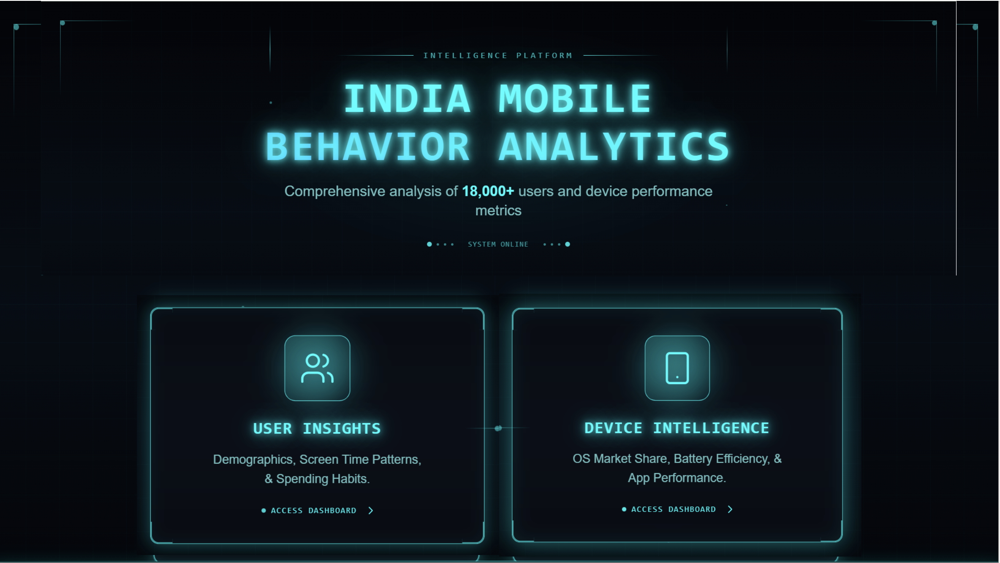
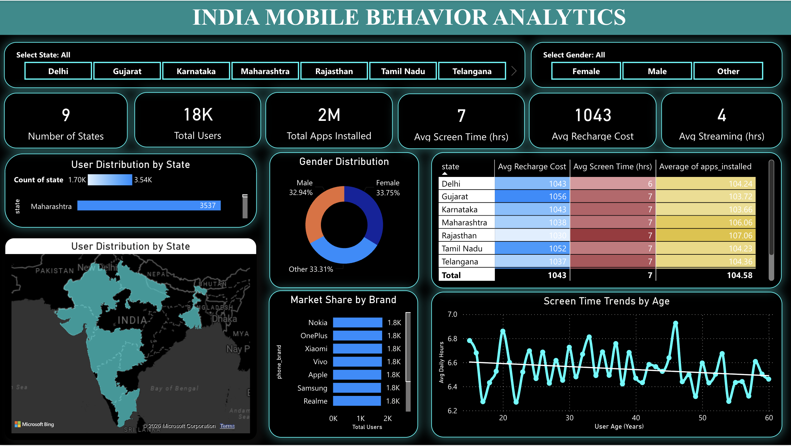
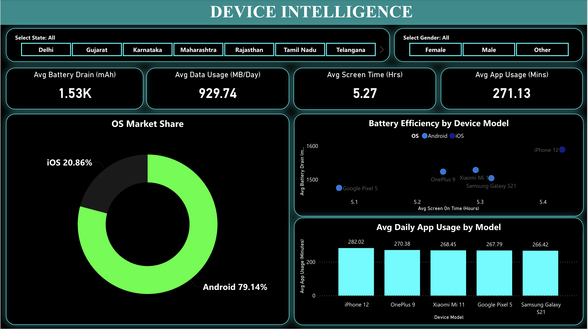

# 📱 India Mobile Behavior Analytics

<p align="center">
  
</p>

<p align="center">
  <strong>An interactive Power BI dashboard exploring mobile user behavior, device performance, and usage patterns across India.</strong>
</p>

<p align="center">
  
  
  
</p>

---

## 📌 Project Overview

**India Mobile Behavior Analytics** is an interactive business intelligence project developed using Microsoft Power BI to explore mobile user behavior, smartphone usage patterns, and device performance.

The dashboard transforms user and device-level data into interactive visual reports, helping explore how demographics, screen time, application usage, spending habits, and hardware characteristics relate to mobile usage.

The project is organized into two analytical dashboards:

- **User Insights:** Explores demographics, geographical distribution, screen time, app installations, and spending patterns.
- **Device Intelligence:** Examines operating system market share, battery efficiency, data usage, screen time, and application usage across device models.

## 🎯 Project Objectives

- Analyze mobile user distribution across Indian states.
- Understand demographic and gender-based user patterns.
- Explore screen time and application usage behavior.
- Examine recharge and streaming spending patterns.
- Compare Android and iOS market distribution.
- Evaluate battery consumption and device efficiency.
- Present insights through interactive Power BI visualizations.

## 📊 Dashboard Preview

### 01 — User Insights

<p align="center">
  
</p>

**Key analytical components:**

| Analysis | Description |
|---|---|
| User Distribution | Geographic distribution of users across states |
| Gender Distribution | User composition by gender |
| Screen Time | Average daily screen time and age-based trends |
| Application Usage | Total application installations |
| Recharge Spending | Average recharge cost |
| Streaming Behavior | Average streaming hours |
| State Comparison | Comparison of recharge cost, screen time, and app installations |

**Key dashboard KPIs:**

| Metric | Displayed Value |
|---|---:|
| Number of States | 9 |
| Total Users | 5,892 |
| Total Apps Installed | 616K |
| Average Screen Time | 7 hours |
| Average Recharge Cost | ₹1,050 |
| Average Streaming Time | 4 hours |

### 02 — Device Intelligence

<p align="center">
  
</p>

**Key analytical components:**

| Analysis | Description |
|---|---|
| OS Market Share | Android vs. iOS distribution |
| Battery Efficiency | Battery drain compared with screen-on time |
| Data Consumption | Average daily mobile data usage |
| Screen Time | Average screen time across users |
| App Usage | Average daily application usage by device model |

**Key dashboard KPIs:**

| Metric | Displayed Value |
|---|---:|
| Average Battery Drain | 1.53K mAh |
| Average Data Usage | 929.74 MB/day |
| Average Screen Time | 5.27 hours |
| Average App Usage | 271.13 minutes/day |

## 🛠️ Tools & Technologies

| Technology | Purpose |
|---|---|
| Microsoft Power BI | Interactive dashboard development |
| Power Query | Data transformation and preparation |
| DAX | Measures, calculations, and KPIs |
| Data Visualization | Interactive charts, tables, and maps |
| Microsoft Excel | Data handling, where applicable |

## 🔍 Business Questions Explored

1. How are mobile users distributed across different Indian states?
2. How do screen-time patterns vary across age groups?
3. What are the differences in mobile usage across demographic segments?
4. How do recharge costs and streaming habits compare?
5. What is the distribution of Android and iOS devices?
6. Which device models show higher battery consumption?
7. How does daily app usage vary across smartphone models?
8. What patterns can be observed between screen time and battery drain?

## 📈 Key Dashboard Observations

- The User Insights dashboard displays 5,892 users across 9 states.
- The dashboard reports approximately 616K total app installations.
- Average screen time on the User Insights page is 7 hours.
- Android accounts for 79.14% of the displayed operating system distribution, compared with 20.86% for iOS.
- Average battery drain is approximately 1.53K mAh.
- Average daily application usage is approximately 271 minutes.

*These observations reflect the displayed dashboard values and should be interpreted within the scope of the underlying dataset.*

## ⚙️ How to Explore the Project

1. Download or clone this repository.
2. Locate the Power BI `.pbix` report file.
3. Open the report using Microsoft Power BI Desktop.
4. Navigate between the User Insights and Device Intelligence pages.
5. Interact with the state and gender filters to explore different user segments.

## 📂 Suggested Repository Structure

```text
India-Mobile-Market-Analysis/
│
├── assets/
│   ├── project-banner.png
│   ├── user-behavior-dashboard.png
│   └── device-intelligence-dashboard.png
│
├── India_Mobile_Behavior_Analytics.pbix
│
└── README.md
```

## 💡 Skills Demonstrated

- Data Analysis and Interpretation
- Data Cleaning and Transformation
- Business Intelligence
- Power BI Dashboard Development
- DAX Calculations and KPI Development
- Interactive Data Visualization
- Analytical Thinking and Data Storytelling

## 🚀 Future Improvements

- Add deeper demographic and regional comparisons.
- Include time-based analysis of mobile usage trends.
- Expand device-level performance comparisons.
- Improve data validation and analytical documentation.

## 👩‍💻 Author

**Sakshi Arora**

B.Tech Computer Science & Engineering | 2027

- GitHub: [@sakshiarora03](https://github.com/sakshiarora03)
- LinkedIn: [Connect with me](https://www.linkedin.com/in/sakshi-arora-b465aa2a1/)
- Email: [sakshiarora7984@gmail.com](mailto:sakshiarora7984@gmail.com)

---

<p align="center">
  <strong>Turning mobile data into meaningful insights.</strong>
</p>
